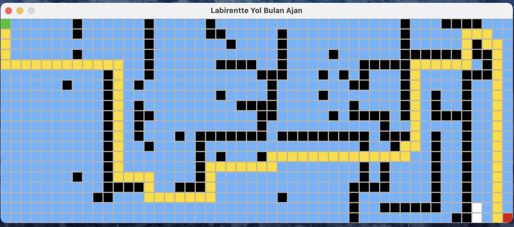
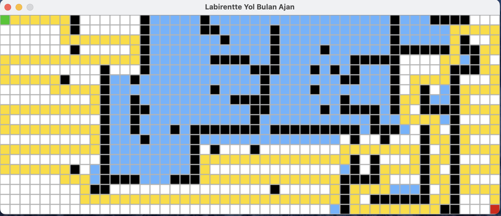
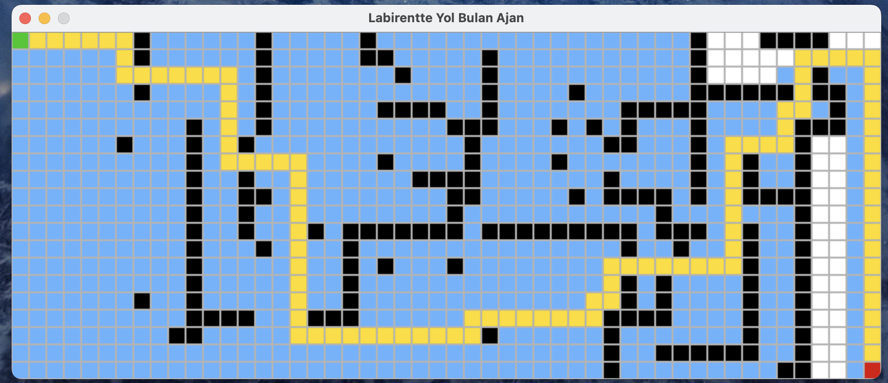
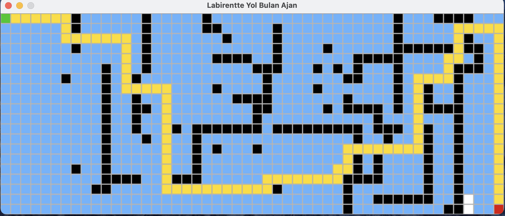

# Labirentte Yol Bulan Ajan

## 1. Proje Hakkında

Bu proje, Python ve Pygame kullanılarak geliştirilmiş, farklı yol bulma algoritmalarını görselleştiren etkileşimli bir labirent uygulamasıdır.


## 2. Projenin Amaçları

- Grid yapısında bir labirent oluşturmak.
- Başlangıç ve hedef noktalarını belirlemek.
- Fareyle engel ekleyip kaldırabilmek.
- BFS ve A* algoritmalarını birleştiren hibrit yaklaşım geliştirmek.
- Farklı yol bulma algoritmalarını karşılaştırmak.
- Arama sürecini ve bulunan yolu animasyonla göstermek.

## 3. Kullanılan Algoritmalar

Projede dört farklı algoritma kullanılmıştır.

### 3.1. BFS (Breadth-First Search)

Genişlik öncelikli arama algoritmasıdır. Queue veri yapısını kullanarak komşu hücreleri katman katman inceler. Hareket maliyetleri eşit olduğunda en kısa yolu garanti eder.

### 3.2. DFS (Depth-First Search)

Derinlik öncelikli arama algoritmasıdır. Stack veri yapısını kullanarak bir yönde mümkün olduğunca ilerler. Yol bulabilir ancak en kısa yolu garanti etmez.

### 3.3. A* (A-Star Search)

Gerçek maliyet ve tahmini maliyeti birlikte değerlendirerek hedefe yönelik arama yapar. 

### 3.4. Hibrit BFS + A*

İki aşamadan oluşur:

1. **BFS:** Başlangıçtan hedefe ulaşılabilecek bir yol olup olmadığını kontrol eder.
2. **A*:** Hedefe ulaşılabiliyorsa en kısa yolu arar.

Hedefe ulaşılamıyorsa A* aşamasına geçilmez.

## 4. Kullanıcı Kontrolleri

| İşlem | Kullanım |
|---|---|
| Duvar ekleme | Farenin sol tuşu |
| Duvar silme | Farenin sağ tuşu |
| BFS çalıştırma | B tuşu |
| DFS çalıştırma | D tuşu |
| A* çalıştırma | A tuşu |
| Hibrit çalıştırma | H tuşu |

Algoritmaların ziyaret ettiği hücre sayısı, yol uzunluğu ve çalışma süresi terminal ekranında gösterilir.

## 5. Projenin Çalıştırılması

Bilgisayarınızda Python kurulu olmalıdır.

### 5.1. Projeyi indirme

```bash
git clone GITHUB_REPOSITORY_URL
cd Labirent_Ajan
```

### 5.2. Sanal ortamı oluşturma

```bash
python -m venv .venv
```

MacOS ve Linux için etkinleştirme:

```bash
source .venv/bin/activate
```

Windows için etkinleştirme:

```bash
.venv\Scripts\activate
```

### 5.3. Gerekli kütüphaneleri yükleme

```bash
pip install -r requirements.txt
```

### 5.4. Uygulamayı çalıştırma

```bash
python main.py
```

## 6. Testler ve Performans Sonuçları

Algoritmalar; ziyaret edilen hücre sayısı, bulunan yol uzunluğu ve çalışma süresine göre değerlendirilmiştir.

### 6.1. Aynı Labirentte Algoritma Karşılaştırması

Dört algoritma aynı labirent düzeninde test edilmiştir.

| Algoritma | Ziyaret Edilen Hücre | Yol Uzunluğu | Süre |
|---|---:|---:|---:|
| BFS | 818 | 101 | 2.007 ms |
| DFS | 564 | 245 | 1.510 ms |
| A* | 777 | 101 | 2.586 ms |
| Hibrit BFS + A* | 818 benzersiz | 101 | 5.471 ms |

**Değerlendirme:**

- BFS ve A* aynı uzunlukta yolu bulmuştur.
- A*, BFS'e göre 41 daha az hücre ziyaret etmiştir.
- DFS daha az hücre ziyaret etmiş ancak daha uzun bir yol bulmuştur.
- Hibrit algoritma iki arama aşamasını birlikte yürüttüğü için daha uzun sürede tamamlanmıştır.

### 6.2. Farklı Labirent Düzenlerinde Hibrit Testleri

Hibrit algoritma üç farklı labirent düzeninde test edilmiştir.

| Test | BFS Ziyaret | A* Ziyaret | Yol Uzunluğu | Süre |
|---|---:|---:|---:|---:|
| Düzen 1 | 995 | 966 | 69 | 4.148 ms |
| Düzen 2 | 989 | 960 | 69 | 5.653 ms |
| Düzen 3 | 832 | 791 | 93 | 5.634 ms |

Üç testte de hedefe ulaşılmıştır. Labirent düzeni değiştikçe ziyaret sayısı, yol uzunluğu ve çalışma süresi de değişmiştir.

### 6.3. Ulaşılamayan Hedef Testi

Başlangıç ve hedef arasındaki geçiş duvarlarla kapatılarak test edilmiştir.

| Ölçüm | Sonuç |
|---|---:|
| BFS ziyaret | 440 |
| A* ziyaret | 0 |
| Yol uzunluğu | 0 |
| Çalışma süresi | 0.844 ms |

BFS hedefe ulaşılamadığını belirlemiş ve A* aşamasına geçilmemiştir.

## 7. Ekran Görüntüleri

### BFS Algoritması



### DFS Algoritması



### A* Algoritması



### Hibrit BFS + A* Algoritması



## 8. Veri Seti

Projede harici bir veri seti kullanılmamıştır. Labirent, Python içerisinde 20x50 boyutunda dinamik olarak oluşturulmuştur. Engeller kullanıcı tarafından fareyle eklenip kaldırılmaktadır.

## 9. Proje Dosya Yapısı

```text
Labirent_Ajan/
│
├── main.py
├── README.md
├── requirements.txt
│
└── screenshots/
    ├── bfs.png
    ├── dfs.png
    ├── astar.png
    └── hybrid.png
```

## 10. Sonuç

Bu projede BFS, DFS, A* ve Hibrit BFS + A* algoritmaları kullanılarak etkileşimli bir labirent çözüm uygulaması geliştirilmiştir. Algoritmaların arama süreçleri animasyonla gösterilmiş ve performansları farklı labirent düzenlerinde karşılaştırılmıştır.